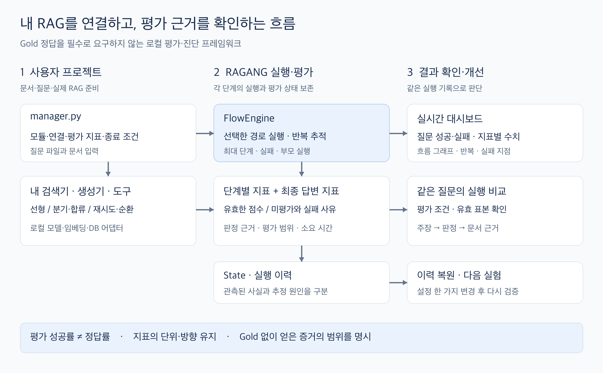
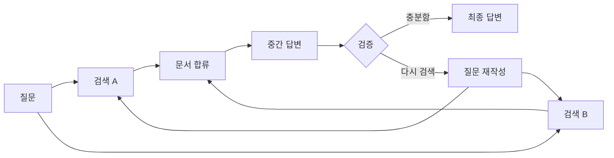

# RAGANG

**정답표 없이, 내 RAG의 검색·답변·실행 흐름을 점검하는 Python 프레임워크**

[](https://www.python.org/downloads/)
[](LICENSE)
[문서](docs/README.md) · [지표 설명](docs/evaluation/metrics.md) · [그래프 실행 계약](docs/graph-rag/execution-trace.md)

RAGANG은 사용자의 RAG를 모듈로 연결해 실행하고, **어떤 문서를 찾았는지, 답변이 근거와 어떻게 연결되는지, 어느 단계가 반복되거나 실패했는지** 확인합니다. 로컬 모델·임베딩·검색 도구를 연결해 On-premise 환경에서 사용할 수 있고, 실행과 진단에 Gold 정답을 필수로 요구하지 않습니다.

대시보드에서 지표별 결과와 실패 원인을 확인하고, 같은 질문으로 실행을 비교해 다음 개선 대상을 고를 수 있습니다.


*실제 실행 엔진과 대시보드로 촬영한 오프라인 예제입니다. 화면의 값은 연결·상태 표시 검증용이며 실제 모델의 성능 측정치가 아닙니다.*

## 이런 작업에 사용합니다

- 검색 설정을 바꾼 뒤 **같은 질문의 검색·답변 지표가 어떻게 달라졌는지** 비교합니다.
- 생성→검증→재검색 같은 흐름에서 **반복별 결과와 최초 실패 단계**를 찾습니다.
- 점수가 낮은 결과와 **판정자가 실패해서 평가하지 못한 결과**를 구분합니다.
- 로컬 어댑터를 사용해 문서·질문·답변을 사용자 환경에서 평가합니다.

평가 성공률은 계산이 완료된 평가의 비율입니다. **정답률이 아닙니다.** 유사도와 문서 충실성도 각각의 신호이므로, 서로 다른 지표를 종합점수로 합치지 않습니다.

## 먼저 한 번 실행하기

필수 환경은 **Python 3.13 이상**입니다. 처음에는 외부 API 키·모델 서버·Milvus 없이 전체 흐름을 확인할 수 있습니다.

### 1. 설치

이 안내는 현재 개선 브랜치를 기준으로 합니다.

```bash
git clone --branch ragang-2026-modernization https://github.com/meta-gang/ragang.git
cd ragang
python3.13 -m venv .venv
source .venv/bin/activate
python -m pip install -e .
ragang --help
```

설치한 버전이 3.14 등이라면 `python3.13`을 해당 실행 명령으로 바꾸세요. Windows에서는 가상환경 활성화 명령으로 `.venv\Scripts\activate`를 사용합니다. 폐쇄망에서는 Python 패키지와 사용할 모델을 미리 반입해야 합니다.

### 2. 예제 프로젝트 생성·실행

```bash
ragang init my_rag_project
cd my_rag_project
ragang run -F sample_rag -Q custom/queries.txt
ragang show -F sample_rag
```

브라우저에서 `http://127.0.0.1:8080`이 열립니다. 기본 `offline` 프로파일은 예제 문서를 메모리에서 검색하고 문장을 발췌해, **실행→평가→이력 저장→화면 확인**을 연결합니다. 생성 모델의 품질을 평가하려면 다음 단계에서 실제 모델을 연결하세요.

`-F`는 `manager.py`에 정의한 흐름 이름입니다. `-Q`는 프로젝트의 `datas/queries/`를 기준으로 한 상대 경로입니다. 종료할 때는 터미널에서 `Ctrl+C`를 누릅니다.

### 3. 화면 읽기

1. **실행 선택:** 확인할 실행과 비교 기준 실행을 고릅니다.
2. **질문 상태:** 시도한 질문 중 성공·실패·미기록 건수를 먼저 확인합니다.
3. **평가 상태:** 유효한 0점, 미평가, 실행하지 않은 평가를 구분합니다.
4. **지표 상세:** 질문·답변과 평가한 범위를 확인합니다. 판정 이유와 문서 근거는 해당 정보를 제공하는 지표에서 볼 수 있습니다.
5. **흐름 확인:** 반복된 단계, 선택한 분기, 실패 지점과 이전 실행을 살펴봅니다.

기본 화면은 실행·질문·문서 번호와 지표 이름을 사용합니다. 재현에 필요한 원본 식별자와 평가 설정은 **기술 정보**에서 확인합니다. 서로 다른 평가 조건은 비교 과정에서 계속 구분됩니다.

문서 번호는 반환된 `ret_docs` 배열의 순서를 뜻합니다. 원본 파일·페이지·URL을 자동으로 복원하는 출처 식별자는 아닙니다.

## 어떻게 연결되어 있나요?



프로젝트에서 다루는 핵심 개념은 다섯 가지입니다.

| 개념 | 역할 | 사용자가 하는 일 |
| --- | --- | --- |
| `manager.py` | 실행할 흐름의 진입점 | `containers()`에서 흐름을 반환합니다. |
| Module | 검색·생성·검증·도구 호출의 한 단계 | `async execute()`의 입력과 출력 딕셔너리를 정의합니다. |
| `Linker` | 단계 사이의 실행 의존성 | 이전 단계, AND 합류, OR 경로를 연결합니다. |
| Metric | 특정 입력의 평가 방법 | 사용할 지표와 입력 참조 순서를 지정합니다. |
| Container | 모듈·지표·종료 정책을 묶은 실행 단위 | 흐름 이름과 최대 단계 등을 설정합니다. |

CLI와 대시보드는 같은 직렬화 결과를 사용합니다. 각 질문의 중간 결과·반복·지표·실패를 보존하므로 저장한 이력을 다시 열어 확인할 수 있습니다. 자세한 내부 구조는 [아키텍처 문서](docs/architecture/overview.md)에 있습니다.

## 내 RAG를 연결하기

처음에는 기존 RAG 전체를 **한 모듈로 감싸고**, 단계별 진단이 필요해지면 검색·생성·검증을 나누는 방식으로 시작할 수 있습니다.

다음은 외부 서비스 없이 실행되는 가장 작은 `manager.py`입니다. `documents`와 `answer`를 만드는 두 부분을 자신의 검색기와 생성기 호출로 교체하세요.

<!-- executable-example: minimal-manager -->
```python
from ragang.container import RAGContainer
from ragang.metrics.builtin.retriever.non_llm_based import JaccardSimilarityMetric
from ragang.modules.custom import CustomModule


class MyRAG(CustomModule):
    async def execute(self, query: str):
        documents = ["RAGANG은 정답표 없이 RAG를 평가하고 실행 실패를 진단합니다."]
        answer = documents[0]  # 자신의 로컬 모델 호출로 교체
        return {"query": query, "ret_docs": documents, "gen": answer}


def containers():
    return [RAGContainer(
        flow_id="my_rag",
        modules=[MyRAG(
            "rag", is_starter=True,
            metrics=[JaccardSimilarityMetric(["rag.query", "rag.ret_docs"])],
        )],
        max_steps=30,
    )]
```

```bash
ragang run -F my_rag -Q custom/queries.txt
ragang show -F my_rag
```

예제의 Jaccard 지표는 질문·문서의 단어 겹침을 측정합니다. 답변의 정확성이나 문서 충실성을 평가하는 지표는 아닙니다. 사용할 지표의 입력·단위·방향·한계는 [지표 목록](docs/evaluation/metrics.md)에서 확인하세요.

단계를 나눌 때는 `Linker("retrieval")`처럼 이전 모듈을 연결합니다. Metric의 `"retrieval.ret_docs"`는 해당 모듈 출력의 키를 참조합니다. 동기식 모델·DB 호출은 `asyncio.to_thread()` 또는 비동기 어댑터로 연결해 화면 갱신을 막지 않게 하세요.

## 실제 로컬 모델로 전환하기

생성한 기본 프로젝트에서 Ollama와 모델을 준비한 뒤 실행합니다.

```bash
RAGANG_PROFILE=ollama \
RAGANG_LLM_MODEL=qwen2.5:3b \
RAGANG_EMBEDDING_MODEL=nomic-embed-text \
ragang run -F sample_rag -Q custom/queries.txt
```

기본 모델 서버 주소는 `127.0.0.1:11434`입니다. 같은 환경변수로 `ragang show`를 실행하면 해당 프로파일로 실시간 테스트합니다. 모델 이름은 설치한 모델에 맞춰 바꾸세요. 기본 프로젝트는 기존 Milvus 컬렉션을 자동으로 삭제하거나 다시 수집하지 않습니다.

사내 서버·기존 벡터 DB는 자신의 어댑터로 연결합니다. 외부 제공자를 선택하면 해당 서비스로 입력이 전송될 수 있으므로, On-premise 요구사항에 맞는 어댑터와 통신 경로를 사용하세요. [생성 프로젝트 사용법](ragang/templates/init_template/README.md) · [로컬 연동 예제](docs/demo/DEMO.md)

## Graph RAG와 Cycle RAG도 사용할 수 있나요?

**분기·합류·재시도·순환으로 구성된 실행 흐름을 연결할 수 있습니다.** 지원 여부는 RAG 이름보다 모듈의 입출력·의존성·종료 조건으로 판단합니다.



| 흐름 | 연결 방법·확인할 점 |
| --- | --- |
| 선형 RAG | 검색→생성, 각 단계 입력·지표와 최종 답변을 확인합니다. |
| 다중 검색·합류 | AND로 필요한 검색 결과를 기다리고, 충돌하지 않는 출력 키로 합칩니다. |
| 조건부 경로 | 출력의 `next`로 실제 실행할 다음 모듈을 선택합니다. |
| 재검색·검증 루프 | 종료 조건과 `max_steps`를 설정하고 반복별 결과·부모 실행을 확인합니다. |
| 지식 그래프 기반 GraphRAG | 그래프 검색기를 모듈로 감싸 반환 문서·답변·소요 시간·실행 경로를 평가합니다. |

중간 `gen`에 후속 모듈이 있으면 실행을 계속합니다. leaf의 답변은 최종 결과가 되며, `terminal=True`와 비어 있지 않은 `gen`으로 명시적으로 종료할 수도 있습니다. 끝나지 않는 루프는 `max_steps`에서 실패 상태와 함께 보존됩니다.

**지식 그래프의 엔티티·관계·커뮤니티 정확성은 기본 제공 지표의 평가 범위와 다릅니다.** 외부 프레임워크 내부 단계를 모듈로 노출하지 않으면, RAGANG도 내부 실행을 볼 수 없습니다. 검증한 복합 흐름과 실행 경계는 [그래프 가이드](docs/graph-rag/execution-trace.md)에서 확인하세요.


다음 오프라인 예제는 두 검색기의 합류와 검증 후 재검색을 실제로 실행합니다.

```bash
# 저장소 루트에서
cd examples/advanced_graph_demo
ragang run -F hybrid_cycle -Q custom/questions.txt
ragang show -F hybrid_cycle
```

같은 프로젝트의 `linear`는 선형 흐름, `graph_module`은 명시한 문서 그래프의 2-hop 탐색입니다.
[예제 설명](examples/advanced_graph_demo/README.md)에서 단계별 출력과 평가 한계를 확인하세요.

## 실행을 비교하는 순서

1. 질문 집합과 평가자 조건을 고정하고 기준 실행을 저장합니다.
2. 검색 설정·프롬프트 등 한 가지를 바꿔 같은 질문을 다시 실행합니다.
3. 대시보드에서 기준 실행을 선택하거나 CLI로 비교합니다.

```bash
ragang compare -F sample_rag
ragang compare -F sample_rag --json
```

점수 차이는 양쪽의 대응 질문 중 유효한 마지막 평가만 사용합니다. 전체 질문 수, 공통 유효 표본, 미평가·미도달 수를 함께 보세요. `--json`은 자동 처리와 재현을 위한 원본 정보를 제공합니다.

## 자주 막히는 부분

| 상황 | 확인할 내용 |
| --- | --- |
| 흐름을 찾지 못함 | 프로젝트 폴더에서 실행했는지, `-F`가 `containers()`의 흐름 이름인지 확인합니다. |
| 질문 파일을 찾지 못함 | `-Q`에 `custom/queries.txt`처럼 `datas/queries/` 아래 상대 경로를 사용합니다. |
| 로컬 모델 연결 실패 | 모델 서버·모델 이름·주소를 확인하고, 먼저 기본 오프라인 프로파일로 연결을 점검합니다. |
| 점수가 미평가로 표시됨 | 입력 부족, 지원하지 않는 형식, 판정 응답 오류와 어댑터 실패를 상세에서 확인합니다. |
| 순환이 끝나지 않음 | 분기 조건·최종 답변·`max_steps`를 확인하고 반복 경로를 따라갑니다. |
| 기존 화면이 보임 | 예전 서비스워커가 설치돼 있었다면 새 버전 활성화 후 한 번 새로고침합니다. |

`history/`에는 질문·검색 문서·답변이 저장됩니다. Git에 추가하지 말고 접근 권한과 보존 기간을 관리하세요. 디스크 이력이 필요 없으면 `ragang run ... --no-save`를 사용합니다.

## 더 자세히 보기

- [문서 전체 목록](docs/README.md)
- [지표·평가 계약](docs/evaluation/EVALUATION.md) · [지표별 식과 해석](docs/evaluation/metrics.md)
- [Graph·Cycle 실행 계약](docs/graph-rag/execution-trace.md)
- [페르소나 기반 개선·검증 보고서](docs/validation/PERSONA_HARDENING_2026.md)
- [표시 단순화·복합 그래프·첫 사용 검증](docs/validation/USABILITY_GRAPH_ONBOARDING_2026.md)
- [한계와 지원 범위](docs/research/limitations.md) · [재현 가능한 빌드](docs/development/RELEASE.md)

개발 검증:

```bash
python -m unittest discover -s tests -v
python -m compileall -q ragang tests
```

실제 모델의 판정 정확도·언어 편향·지식 그래프 품질·대규모 성능은 각 사용 환경에서 별도로 검증해야 합니다. 테스트 통과와 평가 성공률만으로 절대적인 정답률을 주장하지 않습니다.

[MIT License](LICENSE)
