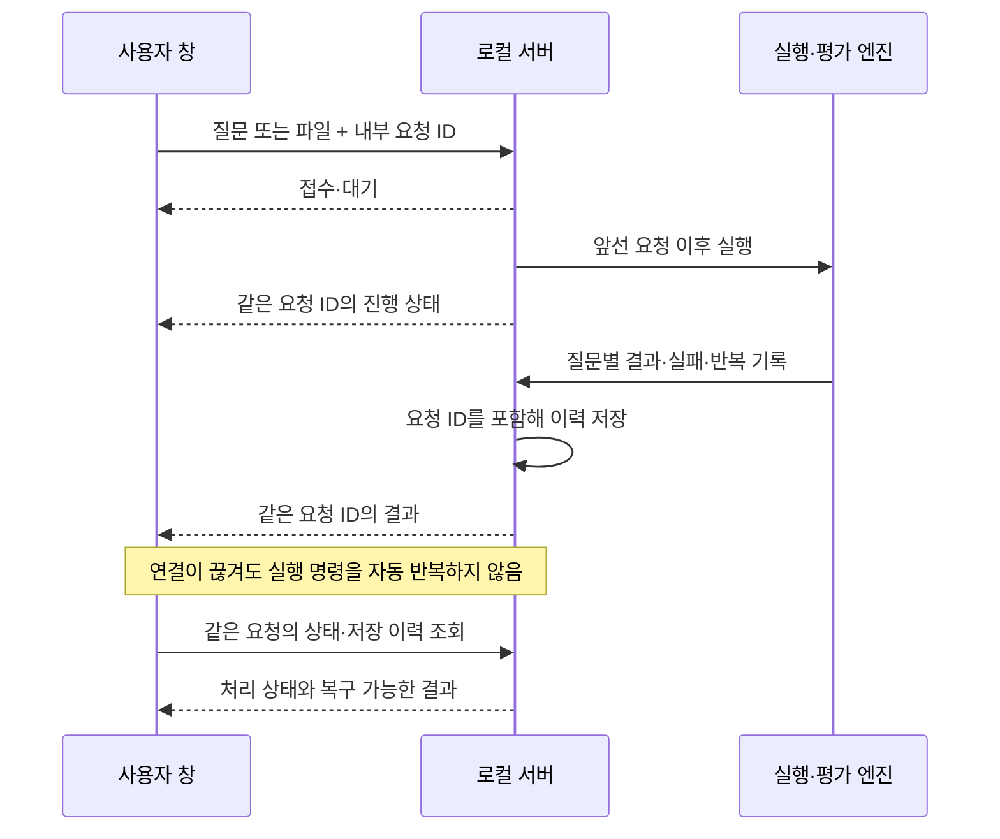

# 대시보드 요청과 결과 연결

이 문서는 대시보드·로컬 WebSocket 구현을 수정하는 개발자를 위한 계약이다.
사용자는 요청 ID를 만들거나 입력하지 않는다. 기본 사용법은 [README](../../README.md)를 따른다.

## 구분하는 기록

- **요청:** 사용자가 실행 버튼을 한 번 눌러 접수한 작업. `request_id`로 연결한다.
- **실행:** 엔진이 만든 단일 또는 일괄 실행. 기존 `run_id`를 유지한다.
- **질문:** 실행한 개별 질문. 같은 문장의 질문도 서로 다른 질문 기록이다.
- **모듈 실행:** 같은 모듈의 반복을 포함한 한 번의 호출. `execution_id`와 부모 기록을 유지한다.

요청 ID는 점수 계산·평가자 설정·질문 대응 표본의 식별자를 대신하지 않는다.
읽기 쉬운 요청 번호는 브라우저 안에서 붙이는 표시 이름이다. 다른 창의 같은 번호가
같은 요청을 뜻하지 않으며 내부에서는 별도 고유 값을 사용한다.



## 실행 메시지

실행 토픽은 `test-query`, `run-rag-file-query`, `run-rag-llm-query`이다.
새 클라이언트는 최상위 `request_id`를 생성해 보낸다. 예제의 `request-example`은
설명용이며 제품은 고유 값을 자동 생성한다.

입력은 영문·숫자로 시작하는 1~128자의 ASCII 영문·숫자·밑줄·하이픈만 허용한다.
구형 클라이언트처럼 필드 자체를 생략하면 서버가 ID를 만들어 접수 응답에 포함한다.
필드를 보내면서 `null`·빈 문자열·배열 등 잘못된 값을 사용하면 접수하지 않는다.

```json
{"topic":"test-query","request_id":"request-example","query":"RAGANG은 무엇인가요?"}
```

진행 토픽 `rag-on`, `module-statu`, `ended-query`, `rag-result-data`와 해당 요청의
`error`는 같은 `request_id`를 포함한다. 결과의 각 State에도
`run_metadata.request_id`를 저장한다. 전송 문장의 내용이나 도착 순서로 소유 요청을 추측하지 않는다.
토폴로지·파일 목록·전체 이력은 공유 정보이며 실행 이벤트와 구분한다.

`get-request-status`와 `request-status`는 요청 상태 조회에 사용한다.
상태 응답은 요청한 연결에 직접 전송하며 별도 구독이 필요 없다.

```json
{"topic":"get-request-status","request_id":"request-example"}
```

`queued`는 대기, `running`은 처리 중, `completed`는 요청 처리 종료,
`failed`는 실행 또는 요청 처리 실패, `unknown`은 해당 요청의 상태를 확인할 기록이 없음을 뜻한다.
`completed`는 답변 정확성이나 모든 지표의 평가 성공을 보장하지 않는다.
`query_ids`, `run_ids`, `persisted`는 결과 연결과 저장 여부에 사용한다.
일괄 작업에서 질문 하나라도 실행에 실패하면 요청 상태는 `failed`다. 저장 실패도
요청의 `failed` 상태와 `persisted=false`로 알린다. 이미 얻은 질문별 기록과 유효한 지표는
보존하며 이를 0점이나 미평가로 덮지 않는다. 지표만 미평가인 경우는 질문 실행 실패와 다르다.

## 복구와 중복 실행

클라이언트는 미접속 상태의 실행 명령을 큐에 넣지 않는다. 접속 복구 후에는 상태와 이력을
조회하고, 기존 요청을 새 요청으로 다시 실행하지 않는다. 기록이 없거나 저장에 실패했다면
그 상태를 알리며 완료로 단정하지 않는다. 저장되지 않은 결과는 서버 종료 후 복구할 수 없다.

같은 ID의 재수신은 별도 실행이 아니다. 서버는 기존 요청을 조회하고 현재 상태를 반환한다.
요청 ID가 없는 과거 이력은 열 수 있지만 현재 요청의 완료를 증명하는 데 사용하지 않는다.

서버는 접수 레코드를 최대 1,024개 메모리에 유지한다. 저장까지 끝난 레코드는 캐시에서
비울 수 있으며, 이후 조회는 메모리의 질문 기록과 디스크 이력에서 같은 ID를 찾는다.
진행 중이거나 저장되지 않은 요청만으로 상한에 도달하면 새 요청을 거절하고 안내한다.
따라서 일반적인 저장 완료 요청이 누적됐다는 이유만으로 1,024회에서 실행이 막히지는 않는다.
중복 여부를 확인할 이력을 읽을 수 없으면 새 실행을 시작하지 않는다.
서버를 다시 시작한 뒤에도 보존된 이력의 요청은 복원할 수 있지만, 이력이 없는 요청은
`unknown`일 수 있다. 이를 자동 재실행의 근거로 사용하지 않는다.

## 범위

서버는 loopback과 기존 로컬 세션 정책을 유지한다. 요청 ID는 상관관계 표식이며 사용자 인증,
권한 분리, 조직별 데이터 격리를 제공하지 않는다. 같은 로컬 대시보드의 저장 이력은 공유된다.
여러 창에서 보낸 실행은 기존 공유 엔진을 보호하기 위해 순서대로 처리한다.

자동 검증의 실행법과 다섯 페르소나의 과제는
[사용자 과제 검증팩](../validation/USABILITY_TASKS.md)에 기록한다.
