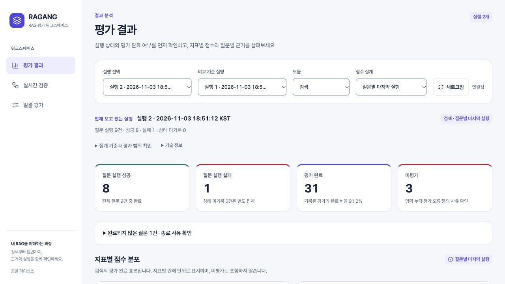
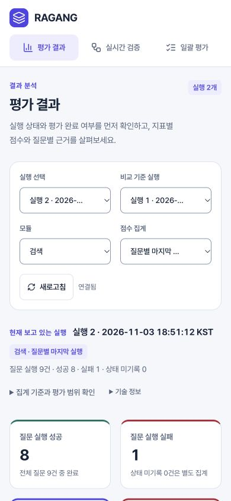
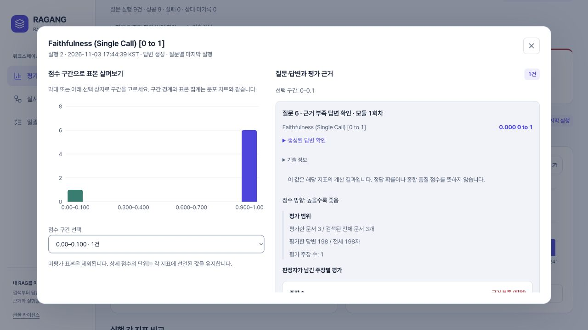
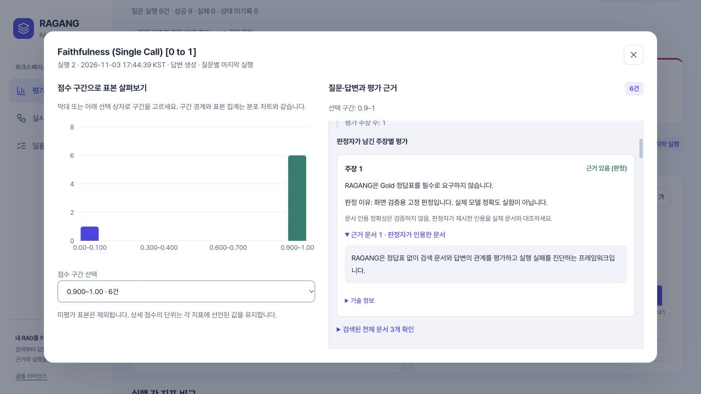
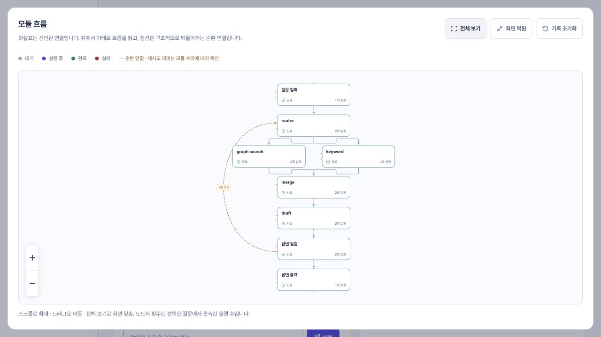
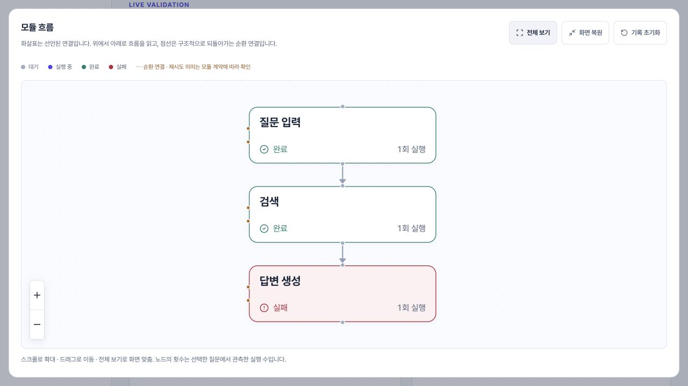
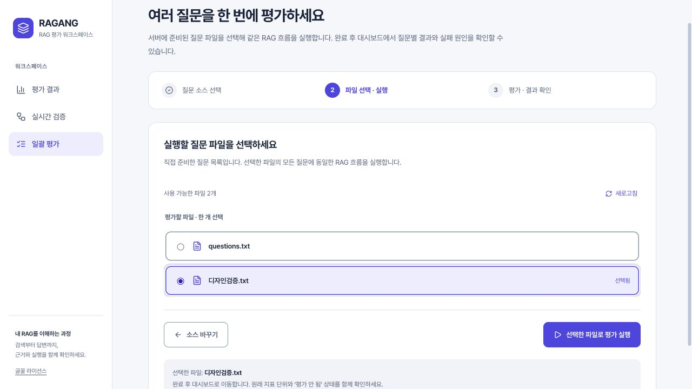
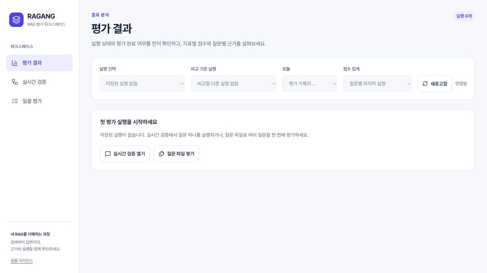
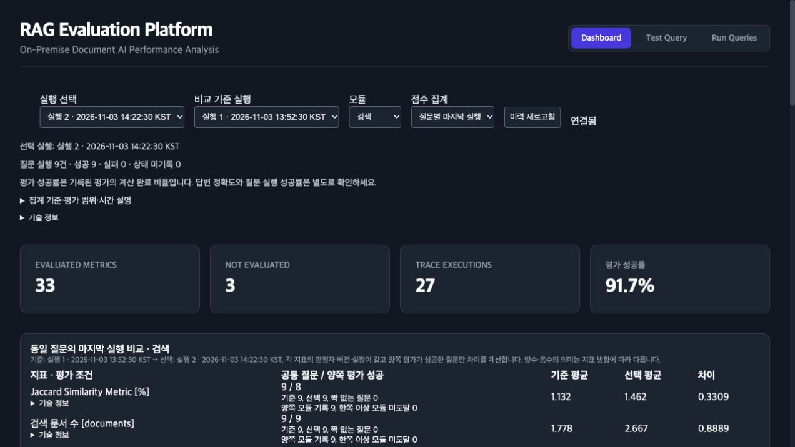

# 대시보드 디자인·한글·사용 흐름 개선 검증

기준일: 2026-11-03. 이번 변경은 `RAG-APP-UI`의 실제 React 화면과 이를 포함하는 RAGANG
브랜치에 적용한다. 아래 페르소나는 검증 과제를 설계하기 위한 가상 사용자이며 인터뷰 결과가 아니다.

## 설계 기준

평가 결과를 처음 읽는 사람이 실행 상태와 평가 상태를 먼저 구별하고, 특정 지표의 근거를
확인한 뒤 자신의 RAG를 다시 실행할 수 있게 구성한다. 본문·표·차트·모듈 노드는 같은
한글 글꼴과 일관된 크기·간격을 사용한다. 기본 화면은 짧은 이름을, 기술 정보는 원본 식별자를
제공한다. 차트와 그래프는 실제 기록만 표시한다.

어두운 패널과 작은 텍스트가 계속 이어지던 화면을 밝은 작업 화면과 흰 패널로 바꾼다.
중요한 결과, 필요한 상세, 고급 기록의 계층을 구분한다. 기본색 외에도 상태 이름과 아이콘을
사용한다. 외부 CDN을 글꼴의 실행 의존성으로 추가하지 않는다.

## 다섯 페르소나와 검증 과제

### 처음 연결하는 개발자

프레임워크에 익숙하지 않다. 메뉴에서 평가 결과·실시간 검증·일괄 평가의 목적을 구별하고,
이력이 비어 있으면 다음 행동을 찾는다. 파일을 선택해 실행한 뒤 결과로 이동한다.
설명 없는 약어, 가짜 성공 상태, 다음 버튼이 없는 빈 화면이 없는지 확인한다.

### 검색 A/B 실험 담당자

기준 실행과 비교 실행, 모듈과 집계 방식을 고른다. 같은 지표의 단위·공통 유효 표본·차이를
읽고 점수 상세를 연다. 선택한 실행과 KPI가 일치하는지, 다른 평가 조건이 합쳐지지 않는지,
차트 축·범례·긴 한글 이름이 겹치거나 잘리지 않는지 확인한다.

### Graph·Cycle RAG 개발자

두 검색기의 합류와 검증·재검색 순환을 실행한다. 그래프의 전진 방향과 순환 연결을 읽고,
각 질문의 모듈 상태·반복·실패를 확인한다. 전체 노드·간선이 보존되고 구조적 순환과
실제 실행 기록이 혼동되지 않는지 확인한다. 방향 배치는 실행 순서 자체를 증명하지 않는다.

### 폐쇄망 운영 담당자

외부 인터넷 없이 로컬 페이지와 글꼴을 연다. 연결 끊김과 재연결, 저장 이력 복원을 확인한다.
글꼴은 번들 안에서 로드하며 로컬 세션·loopback 정책은 유지한다. 이력에 남는 문서·질문·답변의
보존 정책은 UI 변경과 별개다.

### 도메인 QA·제품 담당자

질문 실행 성공/실패와 지표 평가 완료/미평가를 먼저 읽는다. 유효한 0점과 판정 실패를
구별하고 주장·문서·평가 범위를 확인한다. 키보드로 상세를 열고 닫으며 작은 화면에서도
본문과 표를 읽는다. 평가 성공률을 정답률로 부르는 표현이 없는지 확인한다.

## 유지하는 평가 계약

- 유효한 0점과 미평가는 서로 다르다. 입력 부족·형식 오류·판정 실패를 숫자로 대체하지 않는다.
- 지표 이름·단위·방향·평가자 조건과 대응 표본을 보존한다. 이질 지표의 종합점수나 순위를 만들지 않는다.
- 관측 사실과 가능한 원인 가설을 분리한다. 판정자가 제공한 주장·근거를 검증된 사실로 바꾸지 않는다.
- 실행·질문·반복·부모·실제 다음 모듈·실패를 유지한다. 화면용 이름이 계산용 식별자를 대신하지 않는다.

## 검증 기록

작업 시작 상태에서 백엔드 148개, 프런트엔드 38개 회귀 테스트를 통과했다.
UI 변경 후 프런트엔드 72개 회귀와 타입 검사를 통과했다. 백엔드의 평가 수식·실행 엔진은
이번 디자인 변경에서 수정하지 않는다. 최종 소스와 포함 자산의 SHA는
[프런트엔드 빌드 출처](../development/FRONTEND_PROVENANCE.md)에 기록한다.

최종 화면을 포함한 상태에서 백엔드 148개 회귀와 컴파일 검사도 다시 통과했다. 커밋한 UI
소스의 연속 두 production build는 전체 12개 파일의 해시가 일치했다. 포함한 WOFF2와
라이선스가 검증한 원본과 같은 바이트인 것도 확인했다.

### 실제로 바꾼 내용

- 밝은 작업 배경·흰 패널·반응형 탐색·공통 글꼴·상태색으로 세 화면을 통일했다.
- 질문 성공/실패와 평가 완료/미평가를 따로 표시한다. 실행 비교·분포·관측·추정·상세 기록의
  계층을 정리하고 고급 기록은 펼쳐 읽게 했다.
- 기존 WOFF2 파일의 잘못된 형식 선언과 여러 글꼴 가족을 교체했다. 원본 Pretendard Variable
  v1.3.9에 현대한글 11,172자 전체가 포함되는 것을 fontTools로 확인했다. 파일은 수정하지
  않고 로컬로 포함하며, SIL OFL 원문을 실제 웹 빌드와 패키지에도 포함한다.
- 한글 본문은 단어 단위 줄바꿈을 기본으로 하고 긴 이름·문서는 영역 안에서 읽게 했다.
  차트는 동일한 글꼴·단위·축 설정을 사용하고 수치 변경 애니메이션을 제거했다.
- 그래프는 실제 순환 참여 여부를 보존하면서 되돌아가는 연결만 별도 표시한다. 선언된 연결과
  실제 실행 순서를 분리한다. 8개 노드 예제의 배치 높이는 1308px에서 808px로 줄였다.
- 캔버스가 flex 때문에 560px 지정과 달리 약 318px로 줄어 글자를 작게 만들던 결함을 고쳤다.
  기본 560px·모바일 440px을 확보하고 확대 보기·전체 맞춤·이동 기능을 제공한다.
- 점수 상세와 확대 그래프는 배경을 비활성화하고 Tab 이동을 유지하며 Escape로 닫고
  원래 버튼으로 초점을 돌려준다. 본문 이동 링크는 HashRouter 경로를 바꾸지 않는다.
- 파일 목록의 로딩·빈 목록·오류·선택·실행 요청·복구 상태를 구분한다. 선택한 파일의
  라디오 이름이 ‘선택됨’ 표시 때문에 바뀌던 문제도 실제 조작 중 발견해 고쳤다.
- 새 질문 대기 중 과거 지표를 보여주거나 늦은 이력이 선택을 덮는 문제를 막았다.
  재연결로 받은 저장 결과는 직접 선택할 수 있게 동기화하고, 내 요청의 완료라고 자동 단정하지 않는다.

### 실제 브라우저 수용 결과

제어된 예제 프로젝트의 실제 FlowEngine·HTTP·WebSocket과 production build를 사용했다.
판정기는 고정된 테스트 응답을 사용하며 실제 모델 성능 실험이 아니다.

1. 기준 프로파일의 9개 질문에서 성공 8·실패 1, 평가 완료 31·미평가 3을 저장 상태와 대조했다.
   다른 프로파일은 성공 9·실패 0, 평가 완료 33·미평가 3이었다. 과거 실행 선택 시 KPI도 일치했다.
2. 유효한 0점의 질문을 점수 구간으로 선택했고, 판정 오류·빈 검색의 미평가와 구별했다.
   판정자의 문서 인용은 ‘인용 정확성은 검증하지 않음’ 안내와 함께 실제 문서를 열어 확인했다.
3. 빈 이력에서 가짜 0점 KPI를 만들지 않고 두 실행 경로를 제공했다. 생성 질문 파일이 없는
   경우에는 준비 방법을 설명하고 실행을 막았다. 실제 파일 선택→9개 질문 실행→부분 실패를
   포함한 결과 이동과 저장을 확인했다.
4. 복합 검색·합류·검증·순환에서 모듈 8개·관측 단계 14개·추가 반복 6개를 확인했다.
   기본·확대·모바일 화면의 실제 좌표로 노드 8개와 연결 9개가 패널 안에 들어오는 것을 확인했다.
5. 생성 단계 실패는 앞선 성공 단계와 다른 색·상태 이름으로 표시됐고 실행 순서에도 남았다.
6. 320·390·768·1280px 화면에서 가로 넘침을 점검했다. 조회 조건과 주요 버튼의 크기를
   보완했다. 한국어 글꼴의 실제 로딩·형식·표시를 확인했다.
7. 실제 키보드로 본문 이동, 점수 상세와 그래프 확대의 Tab/Shift+Tab·Escape·초점 복귀를
   확인했다. 브라우저 확대를 막던 viewport 제한을 제거했다.
8. 서버 중단 시 연결 복구 안내를 확인하고 새 세션으로 다시 연결해 이력을 조회했다.
   수신 순서 경계 사례와 대기 중 재연결은 실제 페이지를 구동하는 회귀에서도 검증했다.

기본 본문·보조 본문·주요 상태색의 명암비를 점검했다. 성공 배지의 글자를 더 진하게 바꿔
연한 성공 배경에서 약 5.0:1을 확보했다. 이 검증을 접근성 전 항목 인증으로 주장하지 않는다.

### 개선 후

### 개선 전

화면 수치는 실제 엔진과 로컬 HTTP·WebSocket을 사용한 제어된 검증 예제다.
실제 LLM·도메인 정확도 측정 결과가 아니다.

개선 전후 사진에는 서로 다른 검증 프로파일도 포함된다. 수치 차이는 디자인 변경에 의한
모델 성능 개선을 뜻하지 않는다.

## 남은 경계

실제 사용자 인터뷰·도메인 판정 일치율·대규모 그래프 부하·모든 운영체제와 보조공학의
전수 검증은 이번 범위에 포함하지 않는다. 큰 그래프는 전체 보기와 확대·실행 목록을 함께
사용해야 한다. 구조적 되돌림 선만으로 업무상 재시도나 인과 관계를 확정하지 않는다.

현재 프로토콜에는 브라우저 요청별 식별자가 없다. 새 실행 ID를 받기 전에 연결이 끊기거나
여러 클라이언트가 같은 서버에 동시에 질문하면 요청과 결과의 정확한 대응을 자동 증명할 수
없다. 자동 재실행이나 성공 판정을 하지 않고 저장 이력을 직접 선택해 확인하게 한다.
조직 다중 사용자 서비스로 확장한 것은 아니다.
