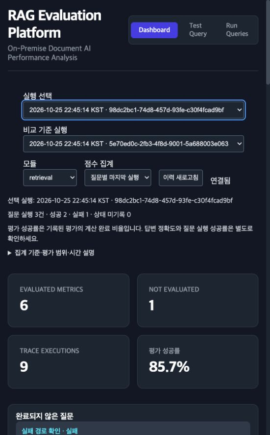
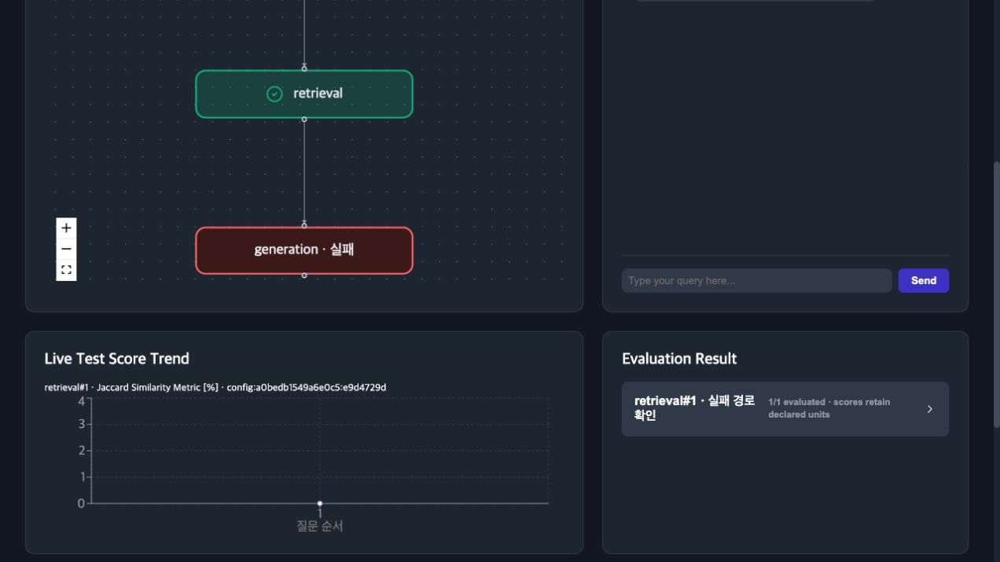
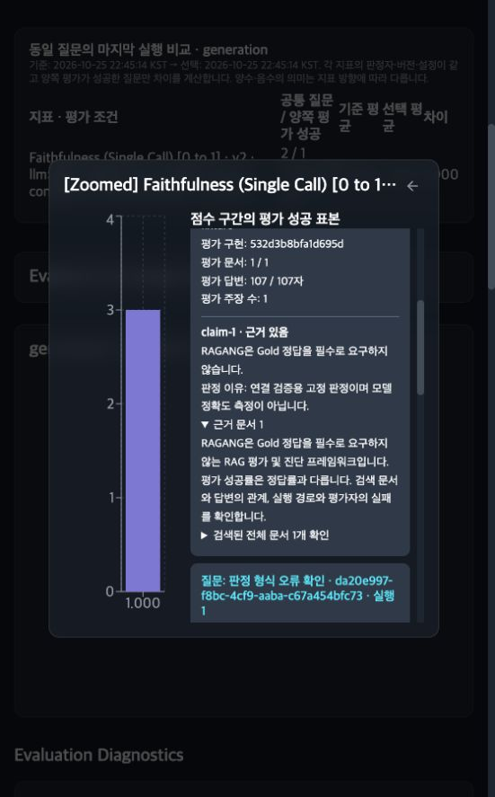

# 페르소나 기반 신뢰성 개선과 검증

기준일: 2026-10-25. 시작 소스는 백엔드 `d851f7e9e6ab7177ac5c037146feeef3af1f2b3f`, 포함 UI `cd8ace19c0e2a25eecb315d5d556682e9305e1cf`이다. 이 문서는 재현된 결함, 변경된 동작, 검증 범위와 남은 한계를 구분한다. 가상 페르소나는 실제 사용자 인터뷰 결과가 아니다.

## 유지한 핵심 계약

- Gold는 실행이나 진단의 필수 조건이 아니다. reference 기반 지표는 선택적이다.
- 유효한 0점과 미평가를 구분하고 유한하지 않은 점수는 거부한다.
- 지표의 단위·방향을 보존하며 이질 지표의 종합점수·모듈 순위를 만들지 않는다.
- 실행 반복·부모 관계·실제 선택 경로와 관측/추론 구분을 보존한다.
- counterfactual은 기록한 조건의 관측 민감도이며 인과 효과나 정답 증명이 아니다.

## 재현 문제와 수정

| ID | 수정 전 재현/위험 | 적용한 해결책 | 검증/한계 |
| --- | --- | --- | --- |
| F01 | 샘플 로딩이 기존 Milvus test 컬렉션을 삭제·재생성 | 기본 메모리 인덱스. Milvus 연결 helper는 기존 컬렉션을 읽기만 하며 없는 컬렉션은 명시 오류 | 모의 DB에서 변경 메서드가 없는 상태로 반복 로딩 가능. 운영 DB 변경 없음 |
| F02 | grounded 누락/문자열을 정상 0으로, claim 누락을 정상 1로 처리; Hybrid의 다른 claim 허용 | JSON 전체 구조·문자열 claim·bool·개수·중복·claim 대응을 엄격 검증. 실패 유형 보존 | 형식 오류는 미평가, 정상 false는 유효 0. 의미 판정의 정확성은 별도 검증 필요 |
| F03 | 중간 gen에서 critic/final 이전 종료 | 선택된 후속 노드가 있으면 draft. leaf gen 또는 terminal=True가 최종 답변; terminal=False는 계속 | 재작성·검증·명시 종료·비정상 terminal 수용 테스트 |
| F04 | 비활성 간선도 의존성 충족으로 기록해 join KeyError/State 유실 | 실제 next만 상태에 반영. 스케줄러·복사·모듈·출력 실패의 State를 finally에서 보존 | AND/OR, 실패·취소·max_steps·부모/반복 테스트 |
| F05 | CLI 부분 실패는 출력 TypeError 또는 성공 State만 저장 | 모든 새 State를 먼저 저장. None 성능 출력 처리. 부분 실패는 비정상 종료 코드 | 부분/전체 실패의 이력·개수 재검증 |
| F06 | 과거 실행 선택 후 KPI는 최신 실행 값 | 선택한 run 하나로 KPI·차트·진단 일치. 전체 시각/실행 선택 제공 | 브라우저 수용 검증과 UI 단위 테스트 |
| F07 | 서로 다른 질문에도 평균 delta를 개선처럼 계산 | 동일 질문·동일 evaluator 조건의 공통 유효 표본으로 paired delta. 전체 요약과 비교 표본 분리 | 서로 다른 질문·누락·중복·평가 실패·설정 변경 테스트 |
| F08 | 임의 Origin에서 로컬 이력 접근 | Origin 제한, ragang show의 임시 세션 인증, 동일 출처 bootstrap/Host 검사 | 실제 WS/HTTP 거부·허용 테스트. 인증된 단일 로컬 작업 영역이며 조직 다중 사용자 서버가 아님 |
| F09 | README 예제 import 실패, 기본 init이 외부 Gemini 요구 | 실행 가능한 README·offline 기본값·명시적 Ollama 프로파일. 질문 생성도 제공자를 명시 | 네트워크 호출 차단 상태에서 init→run→history 검증. 실제 모델은 별도 준비 |
| F10 | 평가 성공률 100%가 질문 실행 실패를 가림 | 질문 성공/실패와 metric 시도/성공/미평가·미도달을 별도 기록/표시 | 비활성 분기는 미도달만으로 실패 판정하지 않음 |
| F11 | 비율만 남아 왜 이 점수인지 추적하기 어려움 | 선택적인 claim evidence·scope·evaluator·failure 직렬화와 UI 열람 | SingleCall/Hybrid에 claim verdict 보존. 모든 metric의 세부 문장 인용을 자동 제공하지 않음 |
| F12 | 상위 5문서/답변 2000자 평가 범위가 숨겨짐 | 원본/사용 문서 수·답변 문자 범위·잘림 scope 기록 | 부분 평가는 전체 정확성 보증이 아님 |
| F13 | ACS 절댓값이 음의 cosine도 높은 값으로 만듦 | 수식은 기존 의미를 유지하고 legacy 버전/실험 proxy와 한계를 명시 | 반대 벡터 경계 테스트. 의미 변경은 향후 별도 metric/version으로 진행 |
| F14 | prompt 속성이 바뀌어도 provenance 동일 | 내용은 제외하되 명시적 prompt_version/corpus_version/model_digest/decoding 설정 기록 | 사용자가 버전 ID를 정확히 지정해야 함. 동일 ID가 실제 내용 동일성의 증명은 아님 |
| F15 | WS 재연결 후 구독이 복원되지 않음 | 구독 목록 재전송·history 동기화·session bootstrap 갱신 | 재연결 기능 테스트와 브라우저 확인 |
| F16 | step를 query 수로 표시, 반복 가중 평균·구간 경계 불일치·다른 단위 한 축 | 질문/단계/최종 실행 집계 선택, 단위별 패널, 일관된 bin 경계 | 같은 사례의 반복 횟수에 따른 집계 의미를 명시 |
| F17 | 실패에도 완료 체크, 질문 이벤트 혼합, 분기 겹침·가짜 Loop | run/query/execution 이벤트와 failed 상태, 실제 순환 판별·분기 레이아웃 | 대규모 그래프 가독성은 지속적인 사용자 검증 대상 |
| F18 | 평가 시간·타임아웃 원인 소실, 같은 초 run 혼합·전체 JSON 덮어쓰기 | 모듈/평가/전체 시간 분리, 실패 유형 보존, run UUID·잠금·원자적 저장, 저장 실패 화면 알림 | 대규모 이력 저장소와 강제 스레드 중단은 지원 범위 밖 |

## 실행·비교 호환성

`terminal`은 bool이어야 한다. `terminal=True`에는 비어 있지 않은 `gen`이 필요하다. 기존 leaf gen 종료는 유지하지만 후속 노드가 있는 gen은 계속 실행되므로, 의도적인 조기 종료는 명시적으로 표시한다. 여러 terminal 경로는 기존의 첫 terminal 도달 시 종료 의미를 유지한다.

비교의 `baseline`/`candidate` 전체 분포는 보존한다. `delta`는 공통 유효 질문의 최종 module execution 기준으로 계산한다. 실행 단계 전체 평균과 질문별 최종값의 평균은 서로 다른 통계다. 예전 테스트의 30점 차이는 실패 표본 누락을 포함했고, 동일 질문의 짝비교에서는 20점 차이로 교정된다. provenance가 없는 legacy 결과는 평가자 동일성을 확인했다고 표시하지 않는다.

새 이력은 기존 host-local 시간 prefix와 고유 run ID를 사용하며, 상태에는 UTC ISO `started_at`을 보존한다. 과거 파일을 삭제하거나 일괄 변환하지 않는다. 한 run을 재전송하면 같은 run을 갱신하고 서로 다른 run은 같은 초에도 분리한다. 저장 실패는 메모리 결과와 함께 사용자에게 명시한다.

## 다섯 사용자 시나리오

### 1. 민서: 처음 연결하는 주니어 개발자

README→init→로컬 문서 검색→답변→평가→history→dashboard를 수행한다. 기존에는 잘못된 import·외부 API 기본값·부분 실패 유실이 첫 실행을 막았다. 이제 offline 연결 확인을 기본 경로로 제공하고, 실제 Ollama 모델은 명시적 프로파일로 전환한다. 오프라인 발췌 결과를 생성 모델의 성능으로 주장하지 않는다.

### 2. 준호: 폐쇄망 운영 담당자

의존성·모델 반입 후 기존 데이터와 내부 서비스를 연결한다. 자동 컬렉션 변경을 없애고, loopback UI에 Origin·임시 세션 검증을 추가했다. 질문·문서·답변이 history에 남는 점과 접근 권한·보존 기간은 운영 정책으로 관리해야 한다. 여러 조직 사용자의 인증·권한 서버로 확장했다고 주장하지 않는다.

### 3. 서연: 검색 A/B 실험 담당자

질문과 evaluator를 고정하고 top-k·chunk·reranker 한 가지를 바꾼다. 전체 평균과 공통 유효 질문의 delta를 구별하고, 미평가·질문 누락·버전 차이를 확인한다. 유사도가 낮아진 유용한 보조 문서를 단순히 나쁜 검색으로 판정하지 않는다. Gold 없는 recall/절대 정답률은 확정할 수 없다.

### 4. 도윤: Agentic/Graph RAG 개발자

draft→critic→rewrite→final, 조건부 AND/OR, 순환·최대 단계 도달을 실행한다. 중간 gen을 최종으로 오인하지 않고, 실제 선택된 next와 부모 실행·반복·실패를 보존한다. GraphRAG 검색 모듈 계측과 지식 그래프의 엔티티·관계·커뮤니티 정확성은 별도 문제다.

### 5. 하린: 도메인 QA·제품 책임자

실행을 선택한 후 질문 완료 상태, 평가 성공률, 지표별 결과, claim 근거를 순서대로 확인한다. 과거 run 선택 시 모든 수치를 일치시키고, 미평가/미도달과 정상 0을 구별한다. 문서 자체가 틀리거나 오래된 경우 높은 충실성도 실제 정답을 보증하지 않는다. 안전한 답변 거절의 적절성은 별도 과업 기준이 필요하다.

## 검증 기록

- 백엔드 전체 회귀: **121/121 통과**. 기존 63개에 엔진 수용 18개, 평가·비교 수용 29개, 로컬 작업 수용 11개를 추가했다.
- Python 3.14.0에서 compileall과 git diff --check 통과. Python 3.13 최소 버전의 별도 실행 검증은 이번 기록에 포함하지 않는다.
- 프런트엔드: npm ci, **24/24 테스트**, 타입 검사 통과. Node 26.10.0 / npm 11.19.0 사용.
- 최종 UI source SHA: `506259325969336b411198ff48415c1683027b51`. 전체 16개 자산의 연속 build 2회와 source commit 후 build가 모두 일치했다.
- 최종 wheel 2회: SOURCE_DATE_EPOCH를 소스 커밋 시각으로 고정하고 byte-for-byte 동일함을 확인했다. SHA-256: `4ff159515a841919f6293ef047e238ba72c065f2818943f209942fd855cabfb9`.
- Wheel의 웹 자산 16개를 source manifest와 비교했고, service worker precache의 3개 참조가 모두 존재한다. 이전 hashed bundle은 포함되지 않는다.
- 별도 디렉터리에 wheel을 설치하여 실제 installed package에서 init→run 2회→compare JSON을 실행했다. 외부 HTTP 요청 차단 상태에서 이력 2개와 대응 질문 1개를 확인했다.
- 연구 예제 A/B/C는 모두 실행 완료했다. 이는 제어된 데모이며 실제 모델·도메인의 정확도 검증을 뜻하지 않는다.

### 실제 브라우저 수용 결과

격리한 프로젝트에서 실제 FlowEngine·HTTP·WebSocket·생성된 production bundle을 사용했다. 판정 어댑터는 deterministic acceptance fixture이며 유료 API나 실제 LLM 품질 실험이 아니다.

1. 과거 실패 실행 선택 시 질문 3건/성공 2건/실패 1건, 평가 성공 6건/미평가 1건/평가 성공률 85.7%가 같은 실행을 가리켰다.
2. 정상 실행은 질문 3건/성공 3건, 평가 9건/미평가 0건으로 전환됐다. 좁은 552px 화면에서도 네 KPI를 모두 표시했다.
3. 생성 모듈에 도달하지 못한 질문을 포함해 공통 질문 3건, 양쪽 모듈 기록 2건, 미도달 1건, 양쪽 유효 평가 1건으로 비교 분모를 보존했다.
4. 세 질문 배치의 모든 State와 실패 진단을 저장하고 dashboard로 복원했다.
5. 실시간 생성 모듈 실패는 빨간 failed 노드이며 앞선 retrieval 완료와 구별됐다.
6. 점수 상세에서 claim·판정 이유·평가 문서 수·답변 범위와 참조한 실제 문서를 펼쳐 확인했다. 인용은 판정자의 미검증 주장으로 유지된다.
7. 서버 재시작 후 페이지를 다시 열지 않고 새 세션 토큰으로 재연결·재구독하고 저장 이력을 복원했다.
8. 이전 서비스워커가 설치된 첫 업그레이드에서는 한 번 새로고침이 필요했다. 새 빌드에서는 HTML과 세션 스크립트를 캐시하지 않는다.

### 검증 화면

실제 Ollama/Milvus 서비스가 실행 중이지 않아 운영 모델/DB를 사용하는 live acceptance는 이번 수정에서 **미평가**다. 설치·연결 계약과 제어된 회귀는 확인했으며, 실제 도메인의 판정 정확도·편향·부하 성능은 이 수치로 주장하지 않는다.

## 남은 한계

- 모든 입력·그래프·도메인에서 결함이 없음을 보증하지 않는다. 명시한 수용 테스트와 실제 화면 흐름을 검증한다.
- 실제 LLM 판정의 calibration·사람 판단 일치율·언어별 편향을 이번 코드 회귀 통과만으로 증명하지 않는다.
- 모듈 timeout은 cooperative async 실행에 적용된다. 동기 사용자 코드나 이미 시작된 judge thread는 강제 종료할 수 없다. 어댑터 자체의 네트워크 timeout도 필요하다.
- batch concurrency 제한은 flow 호출별이며 dashboard 요청은 직렬화된다. 외부에서 여러 engine 호출을 동시에 운영할 때 전역 리소스 정책을 따로 정해야 한다.
- JSON history는 소규모 로컬 작업용이다. 다중 서버·대규모 corpus·장기 이력 운영용 데이터베이스로 대체한 것은 아니다.
- 질의와 문서의 원문을 저장하는 현재 동작은 유지한다. 민감 자료의 보존 정책과 선택적인 no-save를 사용한다.
