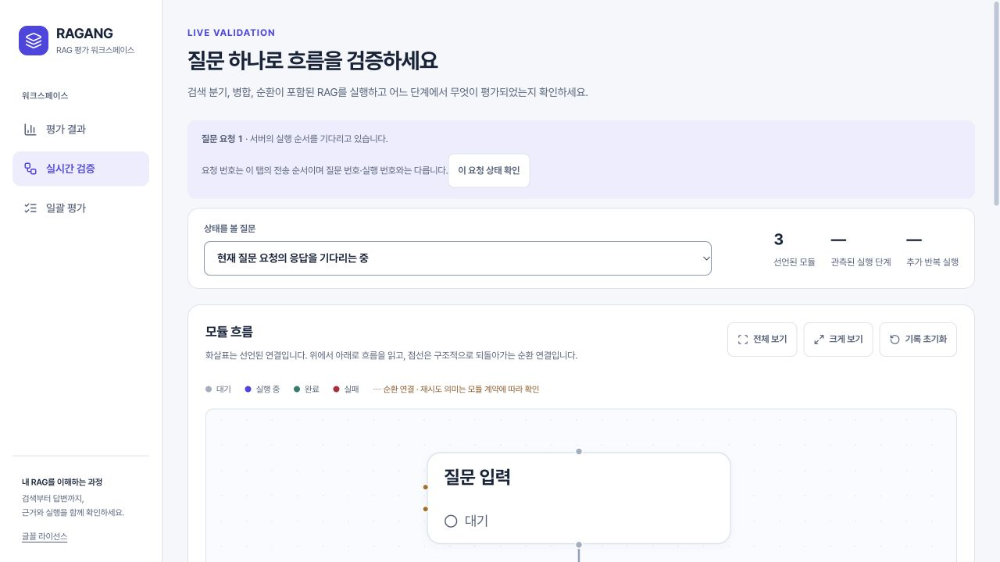
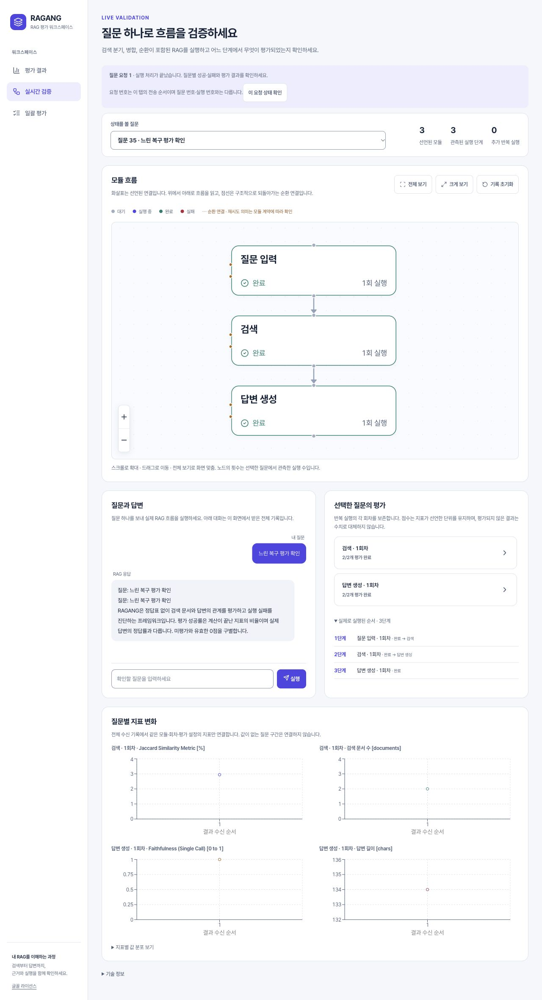
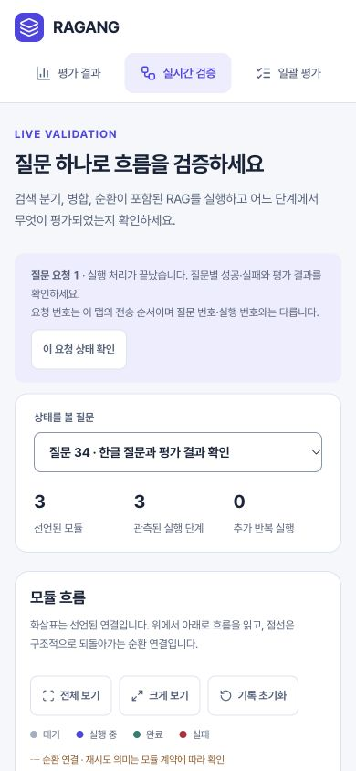

# 요청 연결·자동 사용자 과제 검증

검증일: 2026-11-03. 대상은 `ragang-2026-modernization`과 별도 UI 저장소의
`codex/ragang-ui-2026-modernization` 브랜치다. 가상 페르소나를 사용한 오프라인 수용 검사이며
실제 사용자 인터뷰나 실제 모델 품질 벤치마크는 아니다.

## 해결한 문제

이전 대시보드는 새로 관측한 질문·실행 ID로 현재 요청을 추정했다. 두 창에서 같은 질문을
보내거나 첫 진행 신호 전에 연결이 끊기면 다른 작업의 결과를 자신의 완료로 읽을 가능성이 있었다.
페이지를 떠나면 진행 상태를 받는 콜백도 해제되어, 돌아온 뒤 요청 복구가 불완전했다.
연결 전 실행 명령을 전송 큐에 쌓으면 사용자가 보낸 시점과 실제 실행 시점도 달라질 수 있었다.

이제 실행 버튼에서 생성한 내부 요청 ID를 접수·대기·모듈 진행·질문 종료·결과·오류·이력까지
연결한다. 기본 화면은 `질문 요청 1`, `실행 요청 1` 같은 짧은 이름을 사용하고 긴 원본은
기술 정보에 둔다. 같은 문장의 질문도 문자열로 대응하지 않고 정확한 ID로 대응한다.

- 실행 요청은 접속 중 한 번만 전송한다. 미접속 전송과 중복 클릭은 실제 실행으로 이어지지 않는다.
- 재연결은 기존 요청 상태와 이력을 조회한다. 실행 명령을 자동 반복하지 않는다.
- 다른 창의 실시간 이벤트가 내 질문·진행률·오류·결과 이동을 바꾸지 않는다.
- 탭 안의 공유 요청 기록은 페이지 이동 후에도 유지된다. 전체 저장 이력은 별도로 열 수 있다.
- 이미 선택한 대시보드 실행을 외부 이력 갱신으로 임의로 최신 실행으로 바꾸지 않는다.
- 백엔드는 같은 요청의 중복 접수를 다시 실행하지 않고 상태로 회신한다. 저장한 요청은
  서버 재시작 후에도 이력에서 찾는다. 실패와 미저장 결과도 별도로 알린다.

지표 수식·단위·평가자 조건·질문 대응 방식은 바꾸지 않는다. 요청 완료와 답변 정확성,
질문 실행 성공과 지표 평가 완료를 구분하며 실제 0점과 미평가를 계속 보존한다.

## 반복 검증

[검증팩](USABILITY_TASKS.md)에 다섯 페르소나의 목표·과제·수용 기준·자동 근거와 실제
사용자에게 관찰할 항목을 연결했다. `scripts/verify_usability.py` 한 명령으로 백엔드 전체
회귀·컴파일·UI 회귀·타입·production build를 실행하고 범위와 통과/실패를 JSON에 남긴다.
도구 없음·시간 초과·테스트 0개 수집·중단은 통과로 처리하지 않는다. 질문·답변·토큰·환경변수·
개인 경로와 원시 실행 로그는 보고서에 넣지 않는다.

실제 loopback WebSocket 검사는 두 클라이언트의 동일 질문, 대기 요청, 중복 ID의 다른
내용, 부분 실패, 실패·취소 이력, 잘못된 프레임·ID, 연결 종료 후 저장, 저장 실패,
서버 재시작 후 복구, 캐시 퇴출 후 중복 방지, 이력 확인 실패를 포함한다.

검증한 정확한 UI 소스와 설치 자산은 [프런트엔드 출처](../development/FRONTEND_PROVENANCE.md)에 기록한다.

## 최종 확인 결과

백엔드 **161개**, UI **97개** 회귀와 Python 컴파일·TypeScript 검사를 통과했다.
검증팩의 전체 모드를 직접 실행해 모든 단계와 production build의 통과를 JSON으로 확인했다.
UI 의존성은 잠금 파일을 사용해 캐시에서 새로 설치했다. 보고서의 `dirty=true`는 검증 시점의
작업 트리를 뜻하며, 당시 HEAD만 검증했다는 뜻이 아니다. 최종 UI는 검증한 소스를
`07e733466f7440f8b8e4951f54343806022d022c`로 커밋한 뒤 두 번 빌드해 전체 12개 자산의
파일 집합·SHA-256 일치를 확인했다. 기존 사용자 `.DS_Store` 변경은 커밋에서 제외한다.

독립 코드 검수와 실제 화면에서 다음 경계도 찾아 고쳤다.

1. 결과 직후 완료 상태 프레임을 놓치면 실패를 완료로 유지하던 문제: 결과의 명시적 질문 실패·
   저장 실패를 반영하고 불명확한 결과를 완료로 만들지 않는다.
2. 결과 뒤에 도착한 같은 요청의 오류 원인이 누락되던 문제: 해당 요청 기록에 원인을 보존한다.
3. 저장된 실패 질문을 수동으로 골라도 그래프가 대기로 남던 문제: 저장 trace에서 상태도 복원한다.
4. 과거 일괄 실행이 더 최근 질문보다 먼저 선택되던 문제: 전송 순서와 명시적 이동 대상을 사용한다.
5. 실행 시작 전 오류를 저장 실패로 표현하던 문제: 전송·접수·실행·저장 상태를 구별한다.
6. 390px에서 질문 선택란이 약 64px로 줄던 문제: 선택란은 전체 너비, 통계는 다음 줄로 배치한다.
   실제 선택란 너비는 390px 화면에서 316px, 320px 화면에서 246px로 확인했다.
7. 상수 1점의 `0 to 1` 지표에 `-1~3` 축이 생기던 문제: 실시간·실행 추세 모두 원본 지표의
   명시 단위가 `0 to 1`일 때만 기본 `[0,1]` 축을 쓴다. 관측값이 범위를 벗어나면 축을 확장해
   원값을 보존한다. 다른 단위의 범위를 추측하거나 점수를 변환하지 않는다.

실제 브라우저의 production 화면과 로컬 HTTP·WebSocket·FlowEngine을 함께 사용했다.
판정기는 고정된 가짜 응답이며 외부 모델·Milvus를 요구하지 않는 제어된 예제다.

- 두 창의 같은 질문에서 한 요청은 실행, 다른 요청은 대기로 표시됐다. 창별로 선택한 질문이
  다르고 저장된 요청·실행 ID도 다르며, 이력에는 해당 질문이 정확히 두 번만 실행됐다.
- 실행 중 실제 WebSocket을 종료해 복구 안내를 확인했다. 같은 질문 선택과 요청 이름을 유지하고
  완료 결과를 받았으며, 각 복구 검증 질문의 이력은 한 건씩이었다. 자동 재실행은 없었다.
  [연결 복구 안내 화면](images/requests-2026/reconnecting-request.png)도 기록했다.
- 생성 단계 실패의 원인 안내와 그래프의 실패 상태를 확인했다. 과거 실패 질문을 직접 선택해도
  해당 노드가 실패로 표시됐다.
- 파일의 9개 질문을 일괄 실행한 뒤 그 요청의 실행으로 이동했다. 성공 8·실패 1,
  평가 완료 31·미평가 3을 실제 저장 결과와 대조했다. 이 수치는 모델 품질 측정치가 아니다.
- 320·390·768·1280px에서 가로 넘침을 점검했다. 한국어 글꼴 로딩과 본문 이동의 초점,
  작은 화면의 요청 이름·질문 선택·통계 배치를 확인했다.

## 사용·운영 경계

- 요청 ID는 인증 수단이 아니다. 같은 로컬 서버의 이력은 공유하며 조직별 권한을 제공하지 않는다.
- 동시에 접수한 요청은 공유 엔진에서 순서대로 처리한다. 여러 사람의 작업을 병렬로 실행하는 서비스는 아니다.
- 페이지 이동은 요청 기록을 유지하지만 탭 새로고침·브라우저 종료는 메모리의 요청 이름을 초기화한다.
  저장 이력은 계속 열 수 있으며, 이전 작업을 새 요청의 완료라고 자동 단정하지 않는다.
- 서버 종료 전 저장되지 않은 작업은 재시작 후 `unknown`일 수 있다. 저장 이력이 없다는 이유로
  자동 재실행하지 않는다. 이력을 읽을 수 없으면 중복 여부를 확인할 수 없어 새 실행을 시작하지 않는다.
- 보존 캐시·미저장 요청 상한과 지원 입력은 [요청 계약](../development/DASHBOARD_REQUESTS.md)에 명시한다.
- 모든 edge case의 부재, 실제 사용자 만족도, 도메인 판정 정확도·언어 편향, 초대형 그래프 성능을
  테스트 통과만으로 주장하지 않는다. 실제 사용자 검증은 과제별 관찰 기록을 별도로 수집한다.
