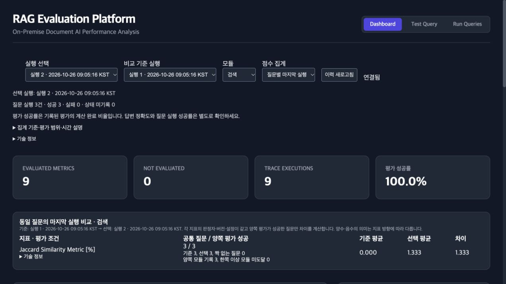
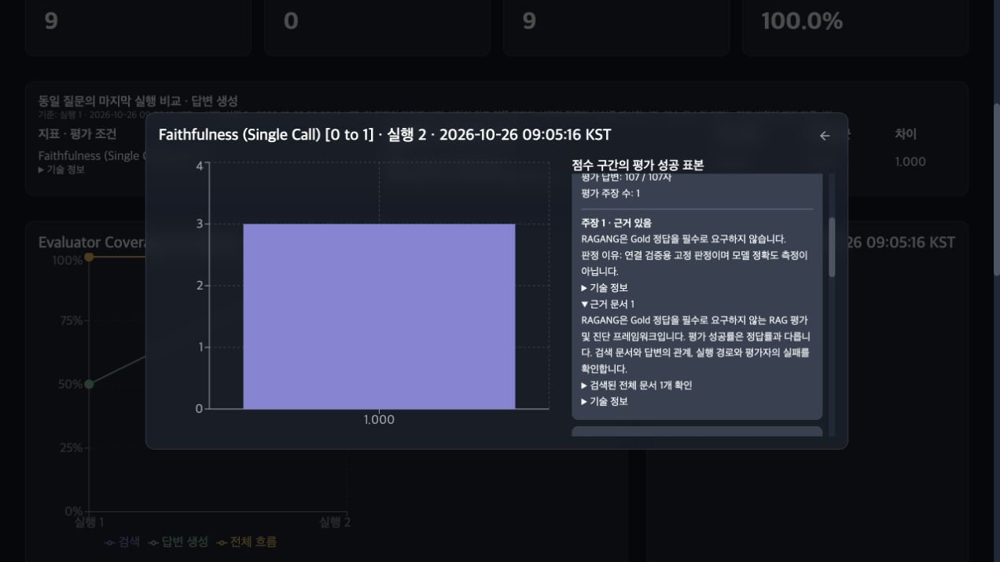
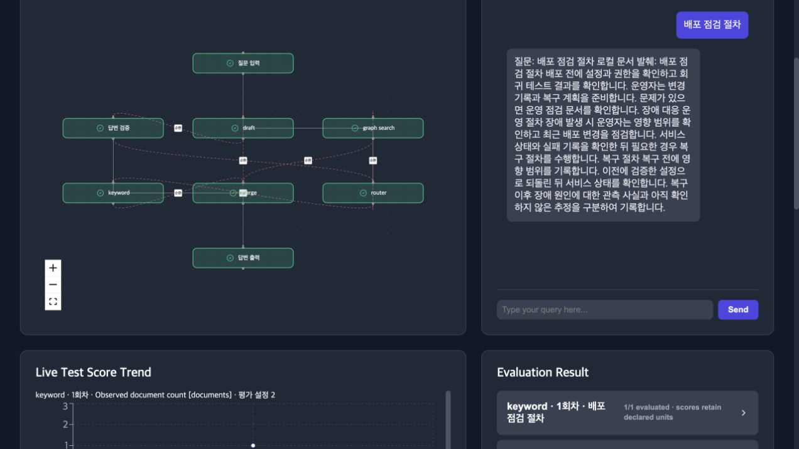

# 표시 단순화·복합 그래프·첫 사용 안내 검증

검증 완료일: 2026-10-26. 대상은 `ragang-2026-modernization`과
`RAG-APP-UI`의 `codex/ragang-ui-2026-modernization`이다.
이 문서는 [앞선 페르소나 개선 보고서](PERSONA_HARDENING_2026.md)에 이어 적용한 변경을 기록한다.

## 사용자에게 보이는 정보

- 실행은 번호와 시각, 질문은 번호와 본문, 근거는 문서·주장 번호로 표시한다.
- 지표는 이름과 원래 단위를 보여준다. 같은 이름·단위에 서로 다른 평가자 조건이 있으면
  `평가 설정 1`, `평가 설정 2`로 구별한다. 이것은 품질 순위가 아니다.
- 원본 실행·질문·모듈·평가자·설정·입력 실행 정보는 접힌 `기술 정보`에 보존한다.
- 표시는 짧게 바꾸되 계산과 짝비교는 원래의 질문·평가자 조건을 사용한다.
- CLI의 일반 비교 출력도 시각과 공통 유효 표본을 표시한다. 자동 처리용 `--json`에는
  원본 식별자와 설정을 유지한다. 표시하는 두 평균과 차이는 같은 대응 표본을 사용한다.

문서 번호는 `ret_docs` 배열의 위치다. 원본 PDF의 페이지나 URL을 복원한 식별자가 아니다.
근거 있음/부족은 판정기가 반환한 결과이며, 그 판정의 진실성을 별도로 보증하지 않는다.

## 표시 단순화 중 추가로 확인한 문제

- 축약한 32-bit 키가 충돌하는 서로 다른 평가자 설정을 실제로 재현했다. 계산용 키는
  전체 canonical 평가자 정보로 구별하고, 화면 이름만 짧게 표시한다.
- 잘못된 지표 이름·단위가 정상 점수로 보이던 이력을 미평가로 처리한다. 정상적인 단위 없는
  0점은 유지한다.
- trace가 없는 첫 질문을 제외하고 번호를 매기던 문제를 고쳐, 상세와 trace가 같은 전체
  질문 순서를 사용한다.
- `output`이라는 이름만으로 최종 답변이라고 표시하지 않는다. 기본 명칭은 중립적인
  답변 출력으로 바꾸고 모듈 반복은 실행 번호와 구별해 `모듈 1회차`로 표시한다.
- 평가 입력 실행을 명시한 새 이력은 그 실행의 문서만 연결한다. 해당 패킷이 없다면
  다른 회차의 문서를 대신 보여주지 않는다.
- CLI에서 두 실행을 명시했는데 선택하지 않은 이력의 시간 정보가 잘못되어 비교까지
  중단되는 문제를 고쳤다. 명시 선택은 불필요하게 전체 이력을 시간 정렬하지 않는다.
- 실제 브라우저에서 큰 순환 그룹의 양 끝 노드가 패널 밖으로 잘리는 문제를 확인했다.
  한 층을 최대 3열로 줄바꿈하고 다음 층의 공간을 확보하며 전체 범위를 맞추는 축소 한계를
  조정했다. 실행 기록을 바꾸지 않고 그래프 배치만 교정했다.

## 실제로 재현해 고친 그래프 문제

1. 대기 중인 합류 모듈의 평가지표가 다음 회차의 전역 최신 출력을 읽었다.
   해당 실행의 조상 출력으로 먼저 결합하고 `scope.input_execution_ids`에 실제 참조를 기록했다.
2. `Linker(loop) | Linker(starter)`처럼 순서를 바꾸면 과거 시작값이 재검색 값을 덮었다.
   완료 순서로 입력을 조립해 최신 완료 의존성이 우선하도록 교정했다.
3. 자식이 입력 리스트를 수정하거나 어댑터가 출력 버퍼를 재사용하면 이전 스냅샷이 바뀌었다.
   실행 입력·출력을 복사해 이전 결과와 다른 분기의 입력을 보존했다.

평가 입력 결합은 `ancestry-first-v1`로 버전을 기록하고 fingerprint를 바꾼다. 이전 결합
의미론의 이력과는 점수 차이를 계산하지 않는다. 기존 이력을 삭제하지 않으며, 비교가
필요하면 같은 질문을 현재 버전으로 다시 실행한다.

## 검증한 흐름과 경계

오프라인 예제 [advanced_graph_demo](../../examples/advanced_graph_demo/README.md)의 실제
CLI 실행·이력 저장을 각 2개 질문으로 확인했다.

- `linear`: 질문마다 3단계와 유효 평가 2건.
- `hybrid_cycle`: 키워드·문서 그래프 검색→AND 합류→초안→검증→재검색→합류→최종 답변.
  질문마다 14단계와 유효 평가 8건. 두 회차의 문서·입력 실행·부모·최종 출력을 확인했다.
- `graph_module`: 명시한 문서 그래프를 실제로 2-hop 순회. 질문마다 3단계와 유효 평가 2건.
- 독립된 두 순환 분기의 수렴 후 합류, 같은 분기의 연속 갱신, 최대 단계 실패,
  양쪽 OR 선언 순서, 교차 경로 평가 입력, 제자리 변경과 재사용 버퍼도 회귀로 확인했다.

AND는 활성 선행 모듈의 최신 출력을 조립하는 combine-latest다. 서로 독립적으로 반복하는
분기의 업무상 회차를 자동으로 동기화하지 않는다. 예제는 공통 라우터와 회차 검사로 이를
명시한다. 비조상 모듈을 참조한 기존 평가는 최신값 대체를 유지하고 실제 출처를 기록한다.

지식 그래프 엔티티·관계·커뮤니티의 정확도, 외부 프레임워크가 감춘 단계, 실제 LLM의
판정 신뢰도는 위 실행 검증으로 확인한 것이 아니다. [실행 계약](../graph-rag/execution-trace.md)에
종료·시간제한·입력 결합 규칙과 한계를 설명했다.

## 첫 사용 경로

README를 설치→오프라인 첫 실행→화면 읽기→최소 연결→로컬 모델→복합 그래프→실행 비교
순서로 바꾸고 아키텍처 그림과 실제 화면을 넣었다. 최소 `manager.py` 코드 블록을 임시
프로젝트에 복사해 실제 CLI의 실행·평가·저장과 `show` 시작 계약을 테스트한다.
모델 네트워크를 차단하므로 예제의 외부 서비스 불필요 조건도 함께 확인한다.

## 다섯 페르소나에 미치는 영향

- **처음 연결하는 개발자:** 실행 가능한 작은 예제로 시작하고, 한 모듈로 자신의 RAG를 감싼다.
  다음에는 실제 검색기·생성기를 교체해야 하며 발췌 데모를 모델 성능 실험으로 해석하지 않는다.
- **폐쇄망 운영자:** 기본 오프라인·loopback 흐름으로 연결을 확인하고 모델·패키지를 반입한다.
  이력의 질문·문서 원문 보존과 외부 어댑터 통신은 운영 설정에서 관리한다.
- **검색 실험 담당자:** 짧은 표시 이름으로 실행을 고르되 공통 유효 표본과 평가 설정 차이를
  확인한다. 설정 번호 자체는 우열이나 실험의 인과성을 뜻하지 않는다.
- **Graph·Agent 개발자:** 반복별 부모와 실제 평가 입력을 따라 결함을 진단한다.
  독립 분기의 회차 동기화와 지식 그래프 품질 평가는 직접 정책·지표를 정의해야 한다.
- **도메인 QA·제품 담당자:** 질문 완료 상태→평가 상태→지표→주장·문서를 읽는다.
  기술 정보는 필요할 때 펼친다. 높은 문서 충실성과 실제 사실의 정확성은 구분한다.

## 검증 범위

백엔드 전체 회귀 140개와 Python 컴파일 검사를 통과했다. Python 3.14.0에서 검증했으며
3.13 별도 실행 환경 검증, 실제 Ollama·Milvus 서비스 연동, 대규모 부하·사람 판정과의
일치율 측정은 이번 범위에 포함하지 않는다. 결함이 전혀 없다는 주장은 하지 않는다.

프런트엔드 38개 테스트·타입 검사를 통과했다. 최종 소스 커밋에서 연속 두 production build의
16개 파일 해시가 모두 같았고, index 및 service worker의 참조 파일도 확인했다.
실제 HTTP·WebSocket·엔진으로 기본 화면의 짧은 이름, 펼친 기술 정보의 원본 ID,
주장·문서 번호와 내용, 실시간 복합 루프를 확인했다. 최종 그래프의 8개 노드가 모두
패널 안에 있는지 실제 화면 좌표로도 확인했다. 화면 수치는 제어된 예제의 실행 결과다.

프런트엔드의 정확한 소스 SHA·파일 해시·최종 검사 기록은
[빌드 출처](../development/FRONTEND_PROVENANCE.md)를 기준으로 한다.
